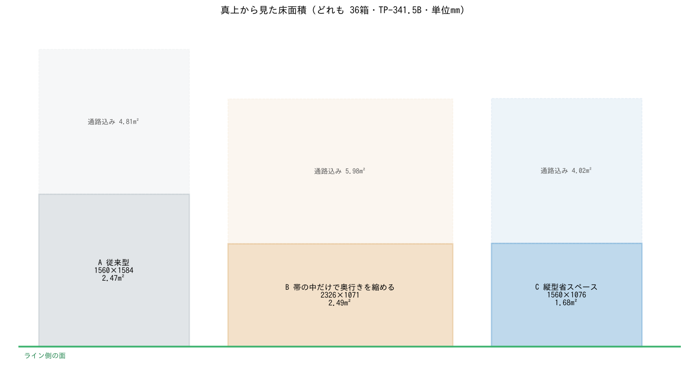
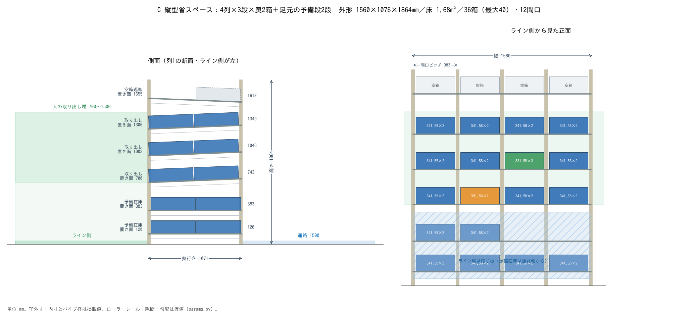

# 検討結果：同じ箱数を置く床面積を最小にする

条件：TP-341.5B（503×335×149mm・17L）を **36箱**、品番 12 種。取り出し側は人（置き面 700mm 以上、箱の上端 1500mm 以下）。
今回は床面積だけを見る（補充を誰がするか、MoMa のリーチなどは別に検討する）。数値はすべて `params.py` の値から計算したもので、仮値を含む。

## 3案の結果

| 案 | 外形 幅×奥行き×高さ（mm） | 棚の床面積（m²） | 通路1500mm込み（m²） | 収納（箱） | パイプ（m） |
|---|---|---|---|---|---|
| A 従来型：傾斜ローラー 4列×3段×奥3箱 | 1560×1584×1905 | 2.47 | 4.81 | 36 | 91.0 |
| B 帯の中だけで奥行きを縮める：6列×3段×奥2箱 | 2326×1071×1864 | 2.49 | 5.98 | 36 | 87.8 |
| C 縦型省スペース：4列×3段×奥2箱＋足元の予備段2段 | 1560×1076×1864 | **1.68（Aの68%）** | **4.02（Aの84%）** | 36（最大40） | 79.3 |

## 分かったこと

1. **人の取り出し域の中だけで工夫しても、床は減らない。** B は奥行きを 2/3 にしたが、そのぶん列が増えて床面積は A とほぼ同じ（2.49m² 対 2.47m²）。取り出し域の高さが決まっている以上、床面積は「箱の総量 ÷ 取り出し域の高さ」でほぼ決まる。
2. **床を減らせるのは、取り出し域の外（足元）を在庫に使ったときだけ。** C は奥行きを 2箱分にし、足元の 120mm と 383mm に予備在庫段を 2 段置いた。幅は A と同じまま奥行きが 1584→1076mm（閉じ板5mm込み）になり、棚の床面積は 32% 減る。
3. **取り出し段は 3 段が上限。** 手を入れて部品を取る空き（100mm・仮）を入れると、段の間隔は 303mm になり、700〜1500mm には 3 段しか入らない。空きを 60mm まで詰めても 4 段目の箱の上端は 1638mm になり、上限を超える。
4. **空箱返却段は高くなる。** 取り出し段の上に置くと、ライン側の置き面は A で 1696mm、C で 1655mm。空箱は軽いが、置く高さとしては高い。A・C に共通の課題。
5. **TP 箱の混在は C の奥行きで成り立つ。** レールの長さ 1071mm に、TP-341.5B は 2箱、TP-391.5B（長さ1005）は 1箱、TP-331.5B は 3箱が入る（図のオレンジと緑）。

## 前回の画面（⑦）からの訂正

画面の「⑦ 縦型省スペース型」は床面積を従来の **49%** としていた。これは取り出し段の上に手を入れる空きを見込まず、取り出し段を 4 段・3 列としていたため。
CAD で空きを入れると取り出し段は 3 段になり、4 列が要る。**正しくは 68%（通路込みで 84%）** で、こちらを正とする。

## 図面

| 案 | 寸法図 | 通路側から | ライン側から |
|---|---|---|---|
| A 従来型 | [図](out/A_conventional_drawing.png) | [画像](out/A_conventional_aisle.png) | [画像](out/A_conventional_line.png) |
| B 帯の中だけ | [図](out/B_band_only_drawing.png) | [画像](out/B_band_only_aisle.png) | [画像](out/B_band_only_line.png) |
| C 縦型省スペース | [図](out/C_vertical_drawing.png) | [画像](out/C_vertical_aisle.png) | [画像](out/C_vertical_line.png) |

## 仮値（実物・メーカー資料で確かめる）

| 項目 | いまの値 | 確かめ方 |
|---|---|---|
| ローラーレールの幅・高さ・ローラー径・間隔 | 40・26・Φ24・50mm | 使うレールの寸法表 |
| ローラーの自走勾配 | 4% | TP 箱（部品入り・空）で実際に流す |
| 手を入れる空き（取り出し段の上） | 100mm | 作業者と部品で試す。段数が 3 段か 4 段かを決める値 |
| 箱と間口ガイドの隙間 | 片側 10mm | 実物の箱で流れと位置ずれを確認 |
| TP-331.5B・TP-391.5B の内寸 | 推定 | メーカーの製品ページ |
| TP 箱の取っ手穴・底の嵌合部の形 | 簡略 | 実物の採寸（床面積には影響しない） |

## 次に確かめること

- **転倒と固定：** C は高さ 1864mm に対し奥行き 1076mm。床へのアンカーか、隣の棚との連結が要るかを確認する。
- **予備段の出し入れ：** 足元（120・383mm）の箱を誰がどう出し入れするか。人なら重さの上限、MoMa ならリーチと姿勢。
- **空箱返却の高さ：** 1655mm を下げる配置（取り出し段の 1 段を返却に回す、別の返却口を設けるなど）を比べる。
- **受けパイプの強さ：** 1 間口あたり最大 3 箱の荷重で、Φ28 パイプのたわみが許容内か。
