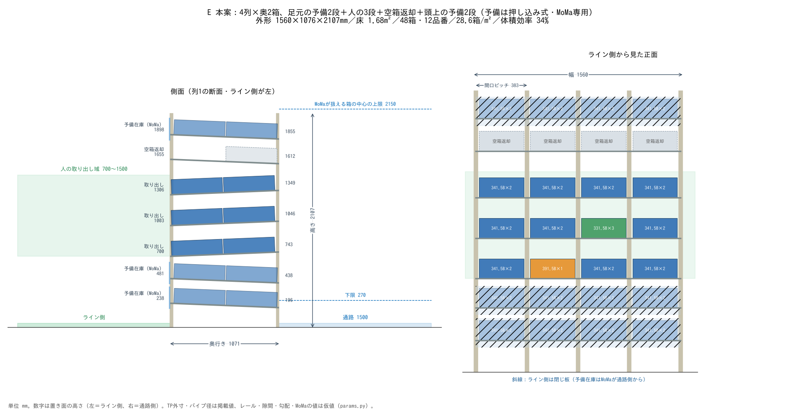
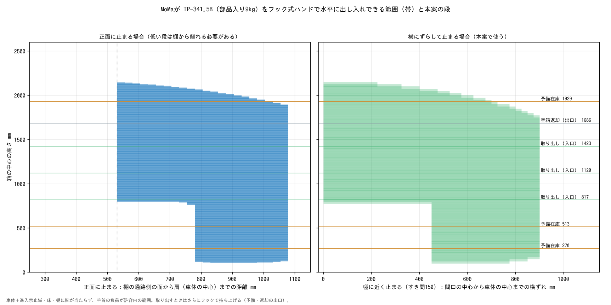

# 検討結果：MoMaの届く高さを使って、床あたり・体積あたりの収納を最大にする

対象：TP-341.5B（503×335×149mm）。品番 12 種以上。人の作業域は 1500mm 以下（取り出し段の箱の上端）で、
**そのすぐ上の段に空箱返却段**を置く。人が使えない足元と頭上は MoMa 専用の予備在庫にする。
**このリポジトリの数値は公開用の仮値（`params.py`）で計算したもの**で、MoMa の寸法・届く範囲は実機と異なる。
実機値は `params_local.py`（git に入れない）に書くと上書きされ、同じ手順で作り直せる。

## 結果（公開用の仮値）

| 案 | 外形 幅×奥行き×高さ（mm） | 床面積（m²） | 収納（箱） | 品番（種） | 床1m²あたり（箱/m²） | 体積効率（%） | 空箱を置く高さ（mm） |
|---|---|---|---|---|---|---|---|
| A 従来型：傾斜ローラー 4列×3段×奥3箱＋最上段に返却 | 1560×1584×1905 | 2.47 | 36 | 12 | 14.6 | 19 | 1696 |
| E 本案：4列×奥2箱、足元の予備2段＋人の3段＋返却1段＋頭上の予備 | 1560×1076×2107 | 1.68 | 48 | 12 | 28.6 | 34 | 1655 |

体積効率＝箱の体積の合計 ÷ 棚の外形の体積。頭上の予備の段数は MoMa の届く高さで決まる（実機値ではもう1段入る）。

## 高さ方向の使い方（reach.py）

MoMa がフック式ハンドで TP 箱を水平に持ち、棚の通路側の面に出し入れできる高さを、側面の2次元で計算した。

- **フック式ハンド**：TP 箱の短辺の取っ手穴に爪を掛け、端面で持つ。手首は箱の端面から手前（通路側）に「手首→フランジ＋ハンド」の長さだけ離れる。
- **条件**：肩→手首の距離が腕の長さの98%以下／上腕・前腕・手首・ハンドが車体＋進入禁止域・床・棚に当たらない／手首の負荷モーメントが許容内。
- **低い段は列の正面から横にずれた位置で止まる（本案）**：MoMa は棚に向き直って止まる（車体の前後の長さが棚の方向）。列の正面で棚の近くに止まると、手首が車体の真上に来て進入禁止域に入る。正面のまま棚から離れる方法（左の図）もあるが、本案は列の正面から横にずれた位置で止まり、腕を車体の横から伸ばす（右の図）。棚に近いまま低い段を扱える。
- **下限**：箱の中心の最低は `MOMA_CENTER_MIN`。爪を取っ手穴の下から掛けに行く（10mm下がる）ときに上腕が車体の進入禁止域に入らない高さとして、3D の動作の干渉確認から決めた。
- **上限**は腕を伸ばし切らない範囲で決まり、棚に近く止まるほど高い。出口ストッパーを越えるための持ち上げ（`HOOK_LIFT`）を含めて判定する。
- **長物（TP-391.5B）**は端面で持つと重心が手首から遠く、手首の負荷で持てる重さが小さい。

## MoMa の動き（当たらない動き）

アーム・ハンド・持った箱が、車体（＋進入禁止域）・天面の箱・棚・床に当たらないことを前提に、次の動きにした。3D の画面では、全手順を1/60秒刻みで動かして干渉を確認している。

1. **棚に向き直って、前進・後退で出し入れする**：MoMa は2輪駆動で横に動けない。通路を走って停止位置の横まで来たら、その場で90°旋回して棚に向き直り、**手と足のシンクロ動作**で箱を間口から引き出し・押し込む：出し入れの前後の移動を、前進・後退と腕の伸び縮みで同時に分担する（高い段ほど腕の分担は小さい。腕と持った箱が当たらない範囲で段ごとに決める）。台車と手首を同じ進み方で動かすので、箱は棚の中をまっすぐ動く。次の間口へ運ぶあいだも、台車の位置合わせと腕の動きを同時に行う。棚の中に入るのはハンドと箱だけで、その間口の空間（置き面〜上の段の下側）の中だけを動く。別の停止位置へは「後退 → 90°旋回 → 通路に沿って走る → 90°旋回」。旋回は棚から十分下がり、手先を走行姿勢にしてから行う。
2. **停止位置を探す**：箱を置いた・持ち上げた・引き出した姿勢と、爪を掛けに行く姿勢のどれも当たらない、左右の位置と棚からの距離を選ぶ。旋回の回数を減らすため、同じ列の「予備→取り出し段」は同じ停止位置で扱う。低い段は列の正面から横にずれた位置、高い段は列の正面に止まる。
3. **天面の箱**：箱の長い向きを車体の前後にそろえて、アームの横に置く。棚に向き直ると箱の長い向きが棚の奥行きの向きになり、端面の取っ手穴に手先（棚の方向）で爪を掛けられる。アームの肩は天面からそれほど高くないので、2段に積んだ箱があるうちはアームを棚の正面に向けない。箱を持って肩の前を回るときは肩より高く持ち上げ、ひじが箱の上に来ないようにする。

## 予備在庫の回し方

1. 予備在庫段は **1段＝1品番**。同じ列の取り出し段の予備にする（足元の予備は下の取り出し段から、頭上の予備は上の取り出し段から順に割り当てる）。押し込み式は後から入れた箱が先頭に来るので、品番を混ぜない。
2. 取り出し段が1箱減ったら、MoMa が予備の先頭の箱を取り出し段の入口へ移す。押し込み式なので奥の箱が転がって先頭に出る。
3. 予備が **空になったら**、MoMa が部品置き場から同じ品番を **2箱** 運び、まとめて押し込む。空になってから入れるので、古い箱が奥に残り続けない。
4. 空箱は人が返却段に置くと通路側の出口へ転がる。MoMa は寄ったついでに回収する。

## 分かったこと

1. 床あたりの箱数を増やせるのは、人の作業域（700〜1500mm）の外を使ったときだけ。
2. MoMa が使える高さは、腕の長さだけでなく「手首が車体の上に来ない停止位置」で決まる。低い段は列の正面から横にずらして止まれば、棚に近いまま扱える。
3. 予備在庫段の通路側の空きは、フックで箱を出口ストッパー（20mm）の上へ持ち上げる分（25mm）に余裕を見た 40mm でよい。上から掴むハンドは段の間に入らない。
4. 空箱返却段は人の作業域のすぐ上（ライン側の置き面 1655mm）。空箱は軽いが、肩より上になる点は確認が要る。

## 次に確かめること

- 転倒と固定：背が高く、上の段に部品入りの箱が載る。床への固定・隣との連結と転倒の計算。
- フック式ハンドで部品入り TP 箱を端面で持ち、出口ストッパーを越えて持ち上げられるか（手首の負荷・取っ手穴の強さ）。
- 押し込み式の予備段で、2箱目で1箱目を押し込む力と、奥の箱が確実に先頭へ出てくるか。
- 旋回（後退・90°旋回・走行・90°旋回）と出し入れの前進・後退を含めた、1箱あたりの補充時間。旋回に必要な通路の幅（棚の面から約1.6m）。停止位置の誤差に対する余裕（最下段は進入禁止域まで余裕が小さい）。
- 仮値（レール寸法・勾配・手を入れる空き 100mm・各隙間・ハンドの寸法と重さ）を実物で確かめる。
