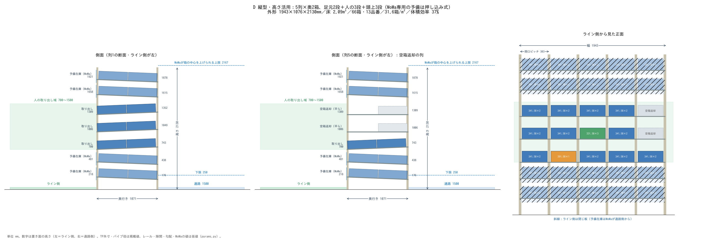

# 検討結果：MoMaの届く高さを使って、床あたり・体積あたりの収納を最大にする

対象：TP-341.5B（503×335×149mm）。品番 12 種以上。取り出しと空箱返却は人（置き面 700mm 以上、取り出し段の箱の上端 1500mm 以下、空箱を置く高さ 1500mm 以下）。
予備在庫は MoMa 専用。**このリポジトリの数値は公開用の仮値（`params.py`）で計算したもの**で、MoMa の届く範囲は実機と異なる。
実機値は `params_local.py`（git に入れない）に書くと上書きされ、同じ手順で作り直せる。

## 結果（公開用の仮値）

| 案 | 外形 幅×奥行き×高さ（mm） | 床面積（m²） | 収納（箱） | 品番（種） | 床1m²あたり（箱/m²） | 体積効率（%） | 空箱を置く高さ（mm） |
|---|---|---|---|---|---|---|---|
| A 従来型：傾斜ローラー 4列×3段×奥3箱＋最上段に返却 | 1560×1584×1905 | 2.47 | 36 | 12 | 14.6 | 19 | 1696 |
| D 縦型・高さ活用：5列×奥2箱、足元2段＋人の3段＋頭上2段 | 1943×1076×2130 | 2.09 | 66 | 13 | 31.6 | 37 | 1309 |

体積効率＝箱の体積の合計 ÷ 棚の外形の体積。

## D の構成

| 区分 | 段 | 置き面の高さ（mm） | 使う人 |
|---|---|---|---|
| 頭上の予備在庫（押し込み式） | 2 | ライン側 1658・1921（通路側はそれぞれ 43 低い） | MoMa |
| 取り出し（傾斜ローラー・奥2箱） | 3 | 700・1006・1309 | 人 |
| 空箱返却（端の1列の2・3段目・平ら） | 2 | 1006・1309 | 人が置いて奥へ押す、MoMaが通路側から回収 |
| 足元の予備在庫（押し込み式） | 2 | ライン側 218・481 | MoMa |

## 分かったこと

1. **床あたりの箱数を増やせるのは、人の取り出し域（700〜1500mm）の外を使ったときだけ。** 取り出し域の中だけで奥行きを縮めても、列が増えて床面積は変わらない。
2. **頭上の上限は、MoMa が箱を水平に持って棚の面に出し入れできる高さで決まる。** 肩の高さ・腕の長さ・手先の長さ・棚とのすき間から計算する（`params.moma_center_max()`）。
3. **空箱返却を最上段に置くと人の手が届かない（A で 1696mm）。** D は端の1列を返却にあて、人の作業をすべて 1500mm 以下に収めた。列が1つ増えるが、品番も13種に増える。
4. **返却段は平らにした。** 勾配を付けると、通路側で下の段との隙間が足りず、取り出し段が上へずれて 1500mm を超える。空箱は軽いので人が押せば足りる。
5. **予備在庫は押し込み式（通路側へ下る勾配）。** 新しい箱で手前の箱を奥へ押し込み、手前を取ると奥の箱が転がり出る。MoMa の手先は棚の面から中に入らずに済み、奥の箱も使える。後入れ先出しになる点に注意。
6. **MoMa は箱を端面で持つ（取っ手穴に掛けるフック式・仮）。** 段の間の空きが小さく、上から掴むハンドは入らない。

## 探し方（optimize.py）

列数 3〜8、奥行きの箱数 2〜3、空箱返却の置き方（1列を返却／最上段に返却）を総当たりし、
品番数・箱数・取り出し段の高さ・空箱を置く高さ・MoMa の届く範囲を満たす中で床面積が最小、箱数が最大のものを選ぶ。
結果は `out/optimize.csv`・`out/optimize.txt`。

## 次に確かめること

- 転倒と固定：背が高く、上の段に重い箱が載る。床への固定・隣との連結と、転倒の計算。
- フック式ハンドで部品入り TP 箱を端面で持ったときの姿勢と、取っ手穴の強さ。
- 押し込み式の予備段で、押し込む力と、奥の箱が確実に先頭へ出てくるか。
- MoMa が止まったとき、人の段の2箱でどれだけもつか（予備在庫は人に扱いにくい）。
- 仮値（レール寸法・勾配・手を入れる空き 100mm・各隙間）を実物で確かめる。
